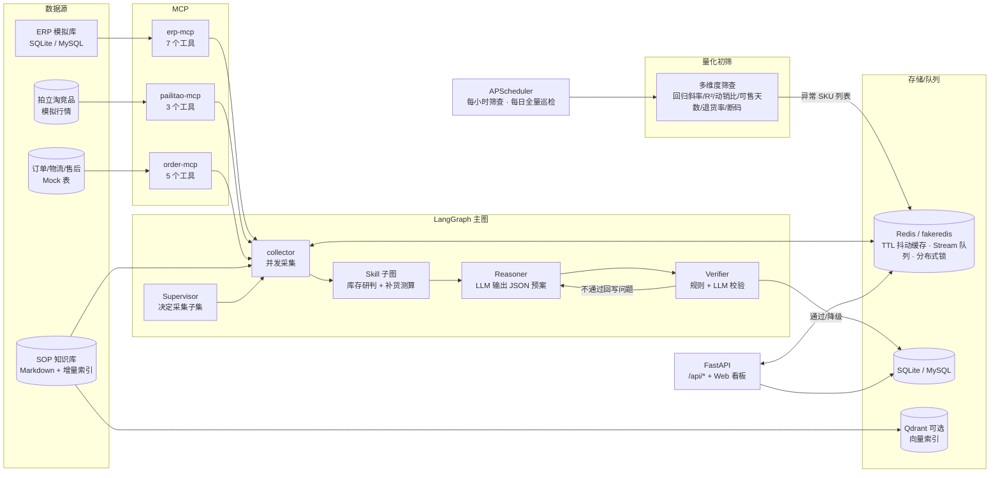
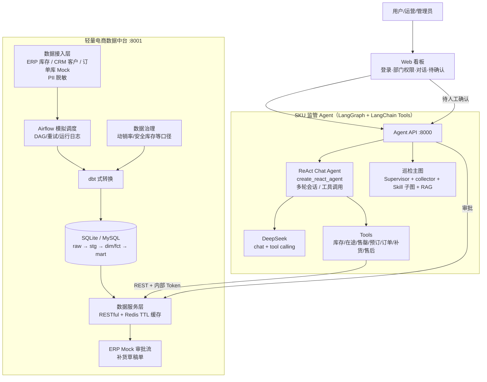
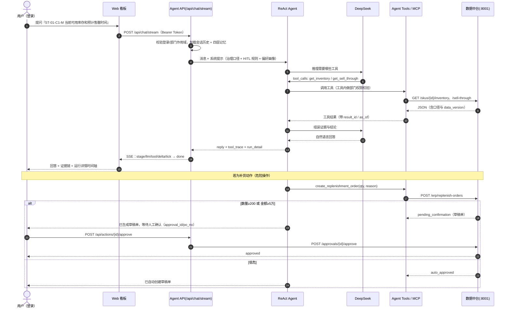

# 架构与关键设计

> 本文件承接 README 里的设计细节：先用两张图说清"谁在调谁"，再按模块讲清楚每个取舍。
> 目录与运行方式见 README「快速开始」，部署见 [DEPLOY.md](./DEPLOY.md)，接口表见 [API.md](./API.md)。

## 1. 总体架构



## 2. 目录结构

```text
src/app/                  # Agent 服务（FastAPI :8000）
├── config.py             # 全部可调参数（LLM/阈值/缓存/队列/数据规模/部门映射/认证）
├── auth.py               # 账号登录、HMAC Token、角色/部门作用域、登录安全记录
├── llm.py                # DeepSeek(LangChain ChatOpenAI) 结构化输出 + JSON 修复重试 + 降级 + 成本估算
├── db/                   # SQLAlchemy 模型（stat_hour 联合索引）、engine、repos、seed
├── cache/                # TTL 抖动缓存、Redis Stream 队列（幂等/消费组）、分布式锁
├── rag/                  # 清洗 → 分块 → 元数据 → 哈希/腾讯 Embedding → BM25 → 融合 Rerank → 引用；可选 Qdrant
├── mcp_servers/          # FastMCP：erp(7) / pailitao(3) / order(5) 三个 server
├── mcp_client/           # memory / stdio / direct 三传输 + 连接池 + 熔断 + 结果缓存 + 重试 + 每工具可靠性统计
├── skills/               # LangGraph Skill 子图：库存研判、补货测算（状态隔离可复用）
├── agents/               # Supervisor、collector、Reasoner、Verifier、主图装配、Prompt
├── memory/               # L0-L3 记忆：工具契约、事实卡/工作集、工作区基线、组织档案、用户偏好
├── observability/        # 延迟分位、LLM 回调、工具成功率、运行态指标
├── pipeline/             # 小时快照聚合、量化筛查、巡检执行器、指标看板
├── api/                  # FastAPI 路由（chat/chat_stream/memory/routes）
└── scheduler.py          # APScheduler 定时任务（默认关闭）
src/data_platform/        # 轻量数据中台（FastAPI :8001）
web/                      # 前端页面（原生 JS，无构建）：SKU 监管 Agent 演示页（index.html）+ Agent 目录页（agents.html）+ 项目简介（about.html ← /about.md）
docs/                     # 本目录（一页纸/简介/架构/接口/配置/部署/UI 指南/检索，共 8 份）
scripts/                  # 数据初始化、评测、演示、运维脚本
tests/                    # 1061 条离线测试（1062 收集，1 条按环境跳过）
docker/                   # Dockerfile / compose / nginx / initdb
data/kb/                  # 14 篇知识库（13 篇 SOP + 1 篇历史案例，提交）
data/eval/                # RAG 评测题集（提交）
```

## 3. 数据中台（`src/data_platform/`）

在 SKU 监管 Agent 之上叠了一套**可独立部署的轻量电商数据中台**，Agent 不直连中台库，所有取数/动作都经 RESTful 接口 + 内部 Token。



### 3.1 用户 ↔ Agent 对话数据流（工具调用 + HITL）



### 3.2 中台分层

| 层 | 实现 |
|---|---|
| 数据接入 | `source_spec.py` 生成演示目录（**中台自举，不读 Agent 库**）；`mock_sources.py` 合成 ERP 库存/在途、CRM 客户/预订、订单快照（`PLATFORM_SOURCE_DB` 显式配置时才复用 Agent 演示库）；`ingest/sync_*.py` 入湖，**入湖前脱敏**（手机号 `138****1234`、姓名 `张*`） |
| 存储计算 | SQLite + `ingest/airflow_mock.py`（DAG 依赖/重试/`etl_run_log`）+ `dbt_like/`（stg→dim/fct→mart，`CASE WHEN` 可移植到 MySQL） |
| 数据治理 | `governance.py` 注册可用库存/安全库存/再订货点/预计售罄/动销率等口径（含公式与同义词），并提供给 Agent 作为 Prompt 上下文 |
| 数据服务 | `api/` FastAPI :8001，**按调用方身份授权**（`authz.py`）+ **按调用方限流**（`quota.py`）+ **调用审计**（`audit.py`）+ 读接口 Redis TTL 抖动缓存与单飞，**缓存随 `data_version` 失效、key 带作用域** |
| 动作 | 补货草稿单/审批（Mock ERP，**条件更新**防并发双写）、跨仓调拨建议 |

### 3.3 中台侧治理（身份 / 作用域 / 配额 / 审计 / 并发）

早期只有一个共享 `INTERNAL_TOKEN`：中台不知道调用方是谁，于是"部门隔离"只能写在每个 Agent 里，
"配额"只能约束单个 Agent 自己，出了问题也无法证明谁调了什么。现在**治理下沉到中台**：

| 能力 | 实现 | 关键点 |
|---|---|---|
| 身份 | `PLATFORM_API_KEYS`（JSON）→ `Principal(agent_id, scopes, departments)` | 一个 key 一个 Agent；`INTERNAL_TOKEN` 仍映射为全权 `legacy-internal`，旧部署零改动 |
| 作用域 | 端点声明 `require_scope("read"/"write"/"approve"/"etl")` + 逐端点 `ensure_department` | 越权返回 **403**（中台是内部边界，需要可诊断；Agent 侧仍用 404 不泄露存在性，这是**有意差异**） |
| 配额 | `quota.py` 每 `agent_id` 1 分钟滑窗 → **429 + Retry-After + X-RateLimit-*** | 多 Agent 同时接入时，中台自己兜住总量 |
| 审计 | `api_audit_log` 每请求一行（谁/路径/状态/耗时/`request_id`/决策/原因）+ `GET /api/v1/audit` | 决策枚举：`allow / unauthenticated / denied_scope / denied_department / rate_limited / not_found / conflict / error` |
| 关联 | `X-Agent-Id` + `X-Request-Id` 双向透传 | Agent 的 `run_detail.steps[].request_id` ↔ 中台审计行可对账 |
| 并发 | 审批 `UPDATE ... WHERE status='pending_confirmation'` + rowcount 判定 | 两个 Agent 同时确认同一单 → 一个 200、一个 409；幂等键冲突捕获 `IntegrityError` 后回查去重（不再 500） |

一句话：**治理不在 Agent 里，在中台里；Agent 可以有很多个。**

## 4. 权限与部门隔离

分层原则：**中台是边界，Agent 是纵深**。

- **中台侧（权威）**：按 `PLATFORM_API_KEYS` 的 `principal.departments` 校验每个 SKU/审批单的品类归属，越权 403；
  审批列表按部门过滤并标注 `scope_filtered/scope_dropped`；动销率不传部门时按可见范围聚合。
- **Agent 侧（纵深）**：登录用户 → 部门 → 品类作用域（`TOOL_SCOPES` + `scope_guard`），越权 404 不泄露存在性。
- **两侧为何不同码**：中台是内部边界（要能诊断"为什么被拒"→403）；Agent 面向终端用户（不暴露 SKU 是否存在→404）。

- **演示账号**：`admin/hhw123`（管理员）、`worker1/hhw111`（男装）、`worker2/hhw222`（女装，童装并入女装）。
- **读接口匿名可看**（只读浏览，演示期的入口设计）；**写操作**（研判、巡检、安全记录、账号接口）必须登录。
- **匿名视角的渲染口径**：登录账号按部门过滤；匿名按「全部门只读」渲染（`scope_categories(None)=None` 不过滤），
  `/api/inspections/{run_id}`、`/api/patrol/{run_id}` 这类「单 SKU 研判结果 + 数据包」同样匿名可读
  （`run_id` 是 uuid，不可枚举）。生产化时把入口收敛到 `require_user`（配置项已预留），或对匿名返回体按部门裁剪。
- **数据隔离**：部门用户按 `SKU.category → 部门` 过滤；跨部门 SKU 详情/研判返回 404（不泄露存在性）。
- **SOP 分权**：知识库文档带 `department` 元数据，检索过滤为「本部门内部 SOP + 通用 SOP」，管理员不受限；单 SKU 研判的 RAG Worker 同样按该 SKU 所属部门过滤。
- **Token**：HMAC 签名（默认 8 小时），伪造/过期/已登出 = 401，前端自动清理并弹登录；登录安全记录只留近 4 小时。
- 去掉「通用 SOP」可见性的开关：`src/app/api/routes.py::_dept_filter` 里去掉 `"通用"` 即可。

### 4.1 对话工具的权限：声明式作用域，而不是「每个函数记得写」

Agent 工具的权限由**声明式作用域 + 单一守卫**实现，而不是「每个函数各自记得写」：
每个工具在声明表（`TOOL_SCOPES`）登记作用域，调用前统一由 `scope_guard` 执行校验，
因此带 `sku_id` 的工具、无 `sku_id` 入参的工具（如 `list_pending_approvals`）、
以及 `department` 由模型填写的工具（如 `get_sales_rate`）走的是同一份规则；
HTTP 路由（`/api/actions/pending`）与工具层共用 `src/app/security/scope.py`，不会出现两处实现不一致。

现在的结构（三个文件，职责不重叠）：

| 位置 | 职责 |
|---|---|
| `src/app/security/scope.py` | 唯一的作用域判定：`visible_categories` / `ensure_sku_visible` / `ensure_order_visible` / `filter_visible_items` / `sku_category_map` |
| `src/app/tools/platform_tools.py::TOOL_SCOPES` | 每个工具声明自己属于哪种作用域（`sku` / `order` / `sku_list` / `department` / `org` / `global` / `local`） |
| `build_platform_tools` | 按声明统一套 `scope_guard`；**漏声明 → 装配直接失败**（导入期自检 + 请求期抛错），不再有「静默少一层校验」 |

装配顺序固定，且顺序本身有语义：作用域守卫 → 写权限拒绝桩（`WRITE_TOOL_NAMES` 默认仅 admin）
→ 结果契约（`result_id` / `as_of` / `summary` / 台账）。列表类工具（`list_pending_approvals`）
在返回体里显式标注 `scope_filtered` / `scope_dropped`，让「过滤掉了多少」可观测，
而不是静默少几条。详见 `docs/API.md` §3.1 的作用域表。

#### 4.1.1 工具面就是提示词（复审 A1）

`StructuredTool.from_function(description=...)` 会**丢掉函数 docstring**，签名推断出的
`args_schema` 也只有字段名与类型。也就是说：写在 docstring 里的使用纪律、参数含义，
模型**一个字都看不到**。现在三处一起补：

1. `specs` 的 `description` 承载"什么时候用/什么时候不要用"（写工具必须写明"需人工确认/
   不会自动审批/不要自己编幂等键"，`save_analysis` 写明"仅在用户明确要求沉淀时调用"）；
2. `_tool_args_schema()` 用**同一份函数签名**生成带 `Field(description=...)` 的 args_schema
   （`PARAM_DOCS` + 按工具覆盖），保证"模型看到的参数说明"与"实际入参"同源、不会漂移；
3. `prompts/chat_system.md` 里再写一条硬规则（沉淀只在用户要求时），机制与提示双写。

`scripts/eval_agent_tooling.py` 把这三条钉成门槛：描述长度、**每个参数都有说明**、
写工具描述含使用条件、args_schema 与签名一致——删一句话或改签名不同步，CI 直接红。

#### 4.1.2 写路径的幂等键不由模型决定（复审 A2）

补货单的幂等键 = `会话 + 轮次 + SKU + 数量 + 原因`，**不接受模型传入的 request_id**：
模型若可以带幂等信息，每编一个新值就会造出新键与新草稿单，幂等性必须由系统掌握。
形参里没有该字段，多传的键会被 `args_schema`（`extra=ignore`）丢弃；
售后工单则由中台在缺键时按「订单 + 原因 + 数量」自算。
（为什么不能交给模型：见本节与 `docs/DEPLOY.md` 的人工确认说明。）

#### 4.1.3 模型点了不存在的工具名（复审 A3）

Multi-Agent 下工具集按 Agent 裁剪（只读 Agent 没有写工具），模型点到"别的 Agent 里有、
当前没有"的工具名是最现实的幻觉形态。LangGraph 的 ToolNode 对未知工具抛的是**空消息**
`RuntimeError`：前端只看到 `RuntimeError:`、拿不到错误码，还会因为"非 fatal"自动降级 POST
把同一轮再跑一遍。

现在：`post_model_hook=validate_tool_calls({实际装配的工具名})` 在模型产出之后、执行工具之前
校验，抛出可读的 `InvalidToolCallError`（带 `bad_tools` / `allowed_tools` / trace）；
`_invoke_agent` 先做**一次纠错重试**（把可用工具名写进系统提示），仍失败才上抛 →
路由层返回 `422 + X-Error-Code: AGENT_INVALID_TOOL_NAME + fatal`，前端不重发（`ui_smoke` §21）。
`run_detail.agent.invalid_tool_retries` 记录本轮纠错次数（提示词/工具集是否让模型困惑的直接信号）。

### 4.2 部门映射的唯一真相在中台

`部门 ↔ 品类`（男装 / 女装含童装）两边各写一份必然漂移。现在：
- 中台 `data_platform/config.py::DEPARTMENT_CATEGORIES` 是唯一真相，通过 `GET /api/v1/metadata/departments` 下发；
- Agent 启动时拉取并 `set_department_categories(...)` 覆盖本地默认值；中台不可用时沿用 `app/config.py` 的本地默认值（离线可跑）；
- `tests/test_demo_catalog_contract.py` 断言两侧**默认值**逐项相等，任何一侧改了都会红。

## 5. 关键设计

### 5.1 LangGraph 主图与校验回路

```text
START → supervisor（LLM 决定采集子集：ERP/SOP 必选，竞品可选）
      → collector（按子集并发采集；未派发的 source 不发起 MCP 调用）
      → merge（并发执行两个 Skill 子图：库存研判 / 补货测算）
      → reasoner（DeepSeek 输出 JSON 预案，坏 JSON 自动修复重试）
      → verifier（规则硬校验：引用有效性/数字一致性/折扣合规/补货合规/SOP 顺序；LLM 复核）
      → 不通过且 attempts<2 → 回 reasoner 带 issues 重写；通过或达上限 → finalize（失败显式标 degraded）
```

- **采集收敛为单节点（不按来源 fan-out）**：LangGraph 的 join 语义要求所有上游分支都被触发，部分派发会让汇合节点不执行，因此采集放在单节点 `collector` 内用 `asyncio.gather` 按 supervisor 的 `tasks` 子集发起调用；`tasks=["erp"]` 时竞品工具调用数为 0（`tests/test_graph_routing.py`）。
- **逐源隔离（P2-6）**：每个源单独 `wait_for(INSPECT_COLLECT_TIMEOUT_SECONDS)`，`gather` 带 `return_exceptions`。竞品/知识库失败 → 整轮标 `degraded` 继续（verifier 会因引用不足给出 degraded 结论）；ERP 失败 → 本 SKU 记 failed，但错误写明"哪个源、为什么"。`degraded` 在 state 里是**粘性**的（`Annotated[bool, operator.or_]`），后续节点不能把它改回 False。
- **为什么规则校验在前**：LLM 校验会「主观加戏」，引用是否存在、补货量是否与 Skill 测算一致、清仓折扣是否 ≥6 折这类硬性项由确定性代码判定，LLM 只做复核与补充。
- **问题与提醒分开（复审 F3 / P4）**：`verification.issues` 只放"不合规"（会触发重写），提醒类进 `verification.warnings`——包括"补货基准用的是现存库存、测算量可能偏低"（F3）与"LLM 校验不可用，仅执行规则校验"（P4）。两处都遵循同一条规则：**提醒不得让 issues 非空**，否则会出现「`passed=true` 但 issues 非空」的自相矛盾展示。
- **多轮**：主图挂 **SQLite `AsyncSqliteSaver`**（`agents/checkpoint.py`，默认 `data/checkpoints.sqlite`，进程重启后线程仍在；配了 Redis + `langgraph-checkpoint-redis` 时可切 Redis saver，挂掉自动回退 SQLite），追问走 `Command(goto="refine")`，复用上一轮采集数据只重跑 reasoner/verifier（实测 4.7s vs 全量 14.5s，MCP 调用增量 0）。
  **追问按"新一轮问题"处理（复审 F3）**：`refine` 会把 `attempts` 归零、`verification` 清空——否则首轮用掉的 revision 预算会让追问校验失败后直接 finalize（0 次重写机会），而且 reasoner 的 prompt 里会带着上一轮的 issues，模型会去修上一轮的问题而不是回答这次追问。
- **线程淘汰的保护窗口（复审 F2）**：`prune_threads()` 只淘汰 `CHECKPOINT_PRUNE_MIN_AGE_SECONDS`（默认 600s）之外没被 touch 过的线程，且研判/追问**开始时也会 touch**——否则一个还在跑的长研判（最长 `INSPECT_TIMEOUT_SECONDS`）会带着上一轮的旧时间被并发裁剪删掉，追问就复用不到上一轮采集数据。
- **线程上限真的生效**：`touch_thread` 在研判/追问结束后登记活跃时间，`prune_threads` 按 `CHECKPOINT_MAX_THREADS`（默认 200）淘汰最旧线程；`/api/health.checkpoint` 暴露 `backend / configured / path / threads / max_threads / warning`，重启后仍按同一上限收敛。

### 5.2 Skill 子图（状态隔离、可单测）

- **口径统一（复审 A1）**：库存一律走 `app/skills/stock.py::available_of()` —— **可用库存**优先
  （`available = on_hand − locked − reserved − hold`），缺失 `available` 时才回落 `stock`（现存）并在
  `notes/stock_source` 里显式标注"按现存估算（偏乐观）"，避免可售天数偏高、补货量偏低；
- **断码按主销码（复审 A1）**：`self_broken_size` = 本码是主销码（30 天尺码占比 ≥15%）且可用为 0；
  同款其它码断开只在 `notes` 说明（`style_broken_size_count`），不给本 SKU 打标签——否则"别的码断了"
  会把还有货的 SKU 判成断码。旧归档没有 `main_size_flag/size_gap_flag` 时回落旧判据并标 `legacy`；
- 库存研判：可售天数、健康度分、风险标签（断码/缺货/积压候选/换季季末/大促备货/退货率）；
- 补货测算：按《补货 SOP》计算安全库存、再订货点、覆盖目标天数、MOQ 取整、单次上限截断，并在提示词中约束「补货量与测算一致（±10%）」；
- **纯计算可单测**：`tests/test_skills.py` 覆盖断码压货/长尾缺货/legacy 回落/缺货/积压/换季/大促/退货率，
  以及 MOQ 取整、单次上限、再订货点优先、7 天在途过滤、`available=0` 不回落等分支。

### 5.3 RAG 链路

> 详细设计、消融数据与规模基准见 [RAG.md](RAG.md)；这里只列骨架。

- **清洗/分块**：front matter 元数据 → 按 Markdown 标题切段 → 中文句读滑窗（320 字/60 重叠）→ 表格行单独成块；
  块正文带 `《文档标题》> 小节` 前缀，`chunk_id` **内容寻址**（`doc_id#sha1(标题+正文)[:8]`，与位置无关）；
- **元数据**：品类/季节/仓/平台/生效起止/版本，检索时按 as-of 日期与 SKU 维度过滤；
  另有**冲突治理元数据**：`authority`（治理口径/部门细则/通用规则/历史案例）与 `key_facts`
  （可比较事实，可按小节归属：`小节|key=value`）；
- **召回**：BM25（标题 2.0 / 小节 1.5 / 正文 1.0 字段加权 + 倒排索引）与向量（默认本地哈希 char n-gram；
  `EMBEDDING_BACKEND=tencent` 或 Qdrant 为可选生产路径）两路，用 **RRF**（`Σ 1/(60+rank)`）融合。
  选择 RRF 而不是加权求和的原因：逐查询 min-max 归一化会让最高分恒为 1.0，从而永远返回 top-k、
  永远不说"不知道"，无答案判定就失去意义；
- **无答案判定**：最像的块余弦相似度 < 0.25（且覆盖率 < 0.25、词法证据不强）→ 返回空结果并标 `no_answer`；
  阈值用 `data/eval/rag_negatives.jsonl`（20 条应弃答）标定，`eval_rag --negatives` 可视；
- **Rerank**：`none / heuristic / llm / cross` 可插拔，带 `RAG_RERANK_TIMEOUT_MS` 预算；
  超时或后端不可用 → 回退融合序并标 `rerank_degraded=true`（不假装排过）；
- **多样性**：同文档最多 `RAG_MAX_PER_DOC` 条 + MMR（相关度先归一化到 [0,1] 再与余弦混合）；
- **引用溯源**：输出 `chunk_id`，导出闸门校验引用真实存在，看板可展开原文片段；
- **口径冲突裁决**：文档在 front matter 声明 `authority` 与（可**按小节归属**、可带**触发词**的）
  `key_facts`，**在候选池上检测、在 top-k 上按相关性收敛**（top-k 带该口径 或 问句命中触发词），
  同一 `key` 多个不同取值时按「中台治理口径 > 部门细则 > 通用规则 > 历史案例」取一条
  （同权威度比版本 → 生效日 → doc id；取值比较前先归一同义单位与"百分比 ↔ 小数"），
  **不丢命中**（只标 `is_primary`），胜出片段原文随 `## 冲突提示` 一起给模型；
  没有相关可比口径时 `conflict_check=unavailable`（不谎称"没冲突"），`none` 附带
  `single_source_keys`；同一文档内部前后矛盾单列 `kind=intra_doc`、不给取舍结论；
  计数与语料覆盖率见 `/api/health.rag_conflicts`、`/api/health.rag_facts`
  （见 RAG.md §2.4，`src/app/common/conflicts.py` + `src/app/rag/conflict.py`）；
- **索引一致性**：按 `kb_doc.chunks_sha`（块集合指纹）与 `chunker_version` 做**按文档对账**，
  只重建变动的文档；向量库写入前先 `delete_doc`，避免文档变短残留陈旧块；
- **评测**：`scripts/eval_rag.py`（38 正样本 + 20 负样本）给出 R@1/3/5、MRR、nDCG@5、**无答案命中率**与消融表；
  `--conflicts` 另跑口径冲突题集（25 题：部门细则压通用、规则压案例、否决不叠加补货、跨部门/未覆盖部门口径、检查不可用、非部门比较负例等）；
  `scripts/bench_rag_scale.py` 用 1200 篇合成语料做规模基准（索引构建 / 加载 / 查询 P95 / 质量）。

### 5.4 Redis 设计

| 场景 | 实现 |
|---|---|
| MCP / RAG 结果缓存 | `TTL × (1+U(0,0.2))` 抖动，写 key 时打散过期时间，避免雪崩；**对话工具取数（只读 GET）也走这层 Agent 旁路缓存**（`CACHE_TTL_PLATFORM=120s`，写操作不缓存），命中会在运行详情的工具时间线标 `✓ 命中` |
| 巡检任务队列 | Redis Stream `XADD/XREADGROUP/XACK`，批次消费；消息幂等键 `sku:hour` 用 `SET NX EX` 去重（重复提交返回 `deduped`） |
| 单 SKU 互斥 / 会话锁 | `SET NX PX` 分布式锁 + token 比对释放，防止多实例重复研判与同一会话并发对话；两把锁都走 **`redis.asyncio`**（等锁用 `asyncio.sleep`，不冻事件循环），后端故障报 `LockBackendError`（503 fail-closed），别人持锁才报 `LockTimeoutError`（409） |
| 降级 | 未配置 `REDIS_URL` 时自动使用进程内 fakeredis；配置了但连不上 → 缓存当 miss（不缓存），`/api/health` 标 `redis(degraded)` |
| 不阻塞事件循环 | 缓存/队列用的是 redis-py **同步**客户端，因此所有 async 调用点只走 `aget/aset/aget_or_set_async`、`aenqueue/aconsume/aack/astats/aclaim_stale`（内部 `asyncio.to_thread`）；同时 `REDIS_SOCKET_TIMEOUT` 必须设（默认 3s）——redis-py 默认 `socket_timeout=None` 是**无限等**，一次挂起会冻住整个进程 |

### 5.5 四层记忆与 Query 理解

| 层 | 落地位置 | 关键机制 |
|---|---|---|
| L0 工作记忆 | `src/app/memory/result_store.py`、`tool_contract.py`、`prune.py` | 工具统一装饰：聚合优先、>50 行只回 `summary` + `artifact_path`（明细落 `data/artifacts/<会话>/`）、每条结果带 `result_id`/`as_of` 并登记 `tool_result` 台账、回答必须引用 result_id；4096/2048/512 三档剪枝仅兜底 |

> **明细上限与 artifact 的可读性（复审 A5）**：内联上限 50 行（`MEMORY_MAX_INLINE_ROWS`），
> 超出只回**前 3 行 + `row_count` + `artifact_path`**，完整明细写 `data/artifacts/<会话>/<result_id>.jsonl`。
> artifact 的读者是**人工/前端/审计**：`run_detail.steps[].artifact_path` 与
> `GET /api/memory/sessions/{id}` 的 `recent_tool_results` 都能定位到它，前端按路径展示/下载。
> **Agent 侧没有回读 artifact 的工具**——这是刻意的：否则模型会把 50+ 行明细灌回上下文，
> 把"聚合优先"的纪律架空。代价是"列出 60 个断码款"这类请求只能给聚合/TOP-N，或说明明细已落
> artifact 供人工查看。
| L1 会话记忆 | `src/app/memory/session_memory.py` + `user_profile.py` | 历史超阈值时生成 `<analysis-facts>` 事实卡（规则抽取、hash 幂等），每轮把 `<working-set>` 实体表并集追加；跨会话的偏好画像（输出偏好 / 关注 SKU）单独存 `user_profile` 并注入提示 |
| L2 工作区记忆 | 根 `AGENTS.md` + `src/app/agents/skills/*.md` + `src/app/memory/workspace.py` | 基线常驻注入；5 个 Skills 只放「名字+一句话」，模型按需 `load_skill` 拉全文。**skills 是模型可见的提示词**，里面写的口径必须与代码同源（断码=主销码、补货公式、清仓 6 折/40%）：`tests/test_skill_docs.py` + `eval_agent_tooling.py` 第 6 组把关，改文档改错会直接红 |
| L3 组织记忆 | `src/app/memory/org_memory.py` + `analysis_result` 表 + `data/analyses/<部门>/` | 结论沉淀为档案（front-matter 含 plan_id/metric_version/result_ids），`search_analyses` 用 BM25 检索并先做部门过滤，`@session` 只带结论脉络。**档案的部门归属按内容推断**（复审 F1）：`save_analysis` 用本轮取过的 SKU/款号/部门级入参定位部门，跨部门或公司级结论才落「全员」；「全员」对全部门可见，所以部门归属错一次就是跨部门泄露——`tests/test_org_memory_scope.py` + `eval_agent_tooling` 第 7 组「档案可见性」把它钉成回归。**引用要么命中、要么明确失败**（复审 S1）：`@session` 的 id 形态严格查找（`ok`/`denied`/`not_found`），标题形态只认关键词命中；失败状态会进 `<session-reference status="…">` 与 `run_detail.references.session_reference`，模型据此如实说明，不再拿"最近一份档案"顶上。**区块里的用户可控文本一律先过 `app/memory/prompt_safety.py`**（复审 T1/T2）：`@session` 的 token 白名单化 + 截断 60 字（防闭合属性/伪造 `status="ok"` 块/撑爆上下文），档案脉络与事实卡正文转义尖括号（防 `</analysis-facts>` 提前闭合） |

Query 理解与重写（`src/app/agents/query_plan.py`）：对话前生成**结构化查询计划**（intent / 实体 / 时间窗 / 必需数据 / 检索关键词 / 假设 / 置信度 / `plan_id` / 口径版本），确定性规则优先、只追加不改写原句；`plan_id` 由规范化 JSON 哈希而来，同输入可复现；置信度 <0.7 **且确实缺实体**时最多追问一次（口径解释/巡检/审批清单、以及带部门品类面的聚合问题不追问）。

### 5.6 模拟数据与评估口径

- 运行窗口内生成 **300 SKU（20 款 × 3 色 × 5 码）× 30 天 × 小时流水**，周末系数 + 平滑季节曲线 + 品类/平台系数；
- 注入 7 类异常共 **46 个 SKU**：断码（6）、下滑（15）、积压（5）、换季（5）、退货率（5）、缺货（5）、大促备货（5，故意作为「筛查假阳、Agent 应判正常」的案例）；
- 每个 SKU 写入 `eval_label`（异常类型 + 期望风险），`scripts/eval_accuracy.py` 实算（某次运行的参考值，脚本会打印每次实际数值，LLM 抽样有波动）：
  - 规则筛查：precision≈78%、recall≈88.6%、F1≈83%（FP 主要是「大促备货期正常高库存」这类需要 Agent 兜底判断的案例）；
  - Agent 研判抽样（风险高/中视为告警）：accuracy≈80–92%，precision 明显高于规则筛查（大促备货假阳会被规范为「正常备货、维持观察」）。
- 业务上常见的 85%/80%/30% 是口径对比值，本仓库只报实际运行结果，评测脚本打印的也是每次真实数值。

### 5.7 运行详情与成本控制

- **每轮运行详情**：`chat_turn_log` 表记录 `run_detail`——查询计划、**时间轴（阶段/模型调用/工具按发生顺序 + `phases` 耗时构成）**、工具步骤（入参/耗时/`result_id`/`as_of`/行数/是否截断/artifact）、本轮与上一轮的事实卡快照、工作集、LLM token 与耗时（含每次调用的耗时/用途）、部门权限命中。
- **时间轴为什么要单独画**：实测一轮 7.8s 里，3 次模型调用 6735ms、3 个工具合计 32ms。工具返回后 LangGraph 会**再调一次模型**，这段秒级等待过去落在「取数：xxx」的文案下，看起来像工具在慢慢跑；现在模型调用单独成行（`llm_start`/`llm_end` 事件 + `run_detail.timeline`）。
- **采集方式**：`tool_contract` 把步骤写入 contextvar（`src/app/memory/runtime.turn_log_context`），`src/app/observability/llm_callback.py` 把每次模型调用写进同一份 turn log 并推 SSE 事件（sink 显式传入，避免回调跑进线程池时 contextvar 丢失），`src/app/llm.py` 用 `turn_usage_context` 归集本轮 token。
- **SSE**：`POST /api/chat/stream` 推 `stage` / `llm_start` / `llm_end` / `tool_start` / `tool_end` / **`delta`（答案 token 增量）** / `tick` / `done`。`run_chat_stream` 用 `agent.astream(stream_mode=["messages","values"])`：`messages` 拿模型逐段输出（过滤 `tool_call_chunks`，不把「我要调工具」的过程当答案），`values` 拿每步完整 state 汇总工具轨迹与最终答复；前端先把气泡逐字写出来，`done` 时用最终答复覆盖（溯源重写后内容可能变化）。不支持流式时自动降级回 `POST /api/chat`。
- **延迟分位**：`src/app/observability/latency.py` 采样 `api`/`tool`/`mcp_call`/`platform`/`llm`/`llm_chat`/`chat_turn`/`rag`/`embedding` 九类（`grounding`/`chat_wait` 由 `record()` 自动登记，暂无中文标签），`/api/metrics.latency` 输出 P50/P95/P99。
- **工具可靠性 + 失败分类**：`tool_stats` 按 `server.tool` 记 calls/ok/retries/timeouts/P50/P95，并把失败分成 `business_error`（参数/权限，重试无用）、`transport_error`（中台/网络）、`timeout`、`breaker_open`（熔断快速失败），看板「工具调用可靠性」表直接展示。
- **出口溯源校验（grounding）**：`src/app/agents/grounding.py` 在答案返回前做确定性检查——答案里的每个来源 id（取数 `res_xxxxxxxxxxxx` 或知识库 `doc#chunk_id`）必须真的来自本轮工具结果；本轮调过工具、答案里有带单位数字却没标来源 → 判失败；不通过先让模型重写一次（只改数字与来源），复核仍不通过就保留答案但标 `degraded`、在气泡上方挂告警条，并把 `status/issues/citations.unknown/numbers.unverified` 写进 `run_detail.grounding`。这是「提示词管不住的问题用确定性代码兜住」的那一层：宁可显式降级，也不假装通过。**两个实现要点**：① 知识库结果按 `KB_EVIDENCE_MAX_CHARS`（默认 6000 字）保留证据正文，SOP 后段的阈值不会落在截断之外；② `tool_call_count()` 同时统计 `steps` 与 `tool_trace`，所以「按 SOP 回答」这类不取数的轮次同样计入工具调用。
- **工具可靠性 + 成本**：`tool_stats.py` 按 `server.tool` 统计成功率/重试/超时/P95；`LLMClient.cost()` 按 `LLM_PRICE_INPUT/OUTPUT` 估算 token 成本，`run_detail.llm.cost_cny` 给出本轮成本。
- **Trajectory 指标（E6）**：`src/app/agents/trajectory.py` 从 `chat_turn_log.payload` **纯函数**推导每轮轨迹——工具数/步数（`llm.calls`）、`(工具, 入参)` 重复调用、预算利用率（`guard.success_calls/max_calls`）、业务错误数；`GET /api/metrics/trajectory` 做窗口聚合（分位 + 按 Agent + 高频工具 + 多轮追问成功率），`scripts/eval_trajectory.py --from-db` 可当回归门槛。**三个指标口径（看图前先列明）**：① 重复调用按 `steps[].args`（200 字截断串）做键，守护侧用的是完整入参指纹，两者是"近似一致"的两套口径，指标侧选前者是为了可复现；② 追问成功率衡量**流程完成度**（grounding 通过、未中止且模型确实给出了正文）；③ `answer_fallback_turns` 单独统计"未给正文/走兜底文案"的轮次（复审 R3）——这类轮次的 `grounding` 是 `skipped`，从成功分子里剔除并单独计数，避免把"没答"算成"答对"。
- **中止台账**：循环/预算/步数中止的轮次没有答复、走不到 `save_turn_log`，所以路由会补写一行 `chat_turn_log`（`grounding_status="aborted"`、payload 带 `error_code` + `guard` 快照 + `agent_id`）。没有这行 `abort_rate` 永远是 0；有了它，守护拦下的轮次**跨重启**可统计（进程内 `tool_stats.outcomes.loop_aborted` 是另一份口径，接口里并列展示）。**同时补一条 assistant 标记消息**（`〔上一轮已中止，未给出结论：<code>〕…`）：否则下一轮历史会带出上一条 user 消息，模型看到两条连续提问、UI 里留下悬空气泡；标记刻意不带数字，避免被事实卡当成"结论事实"收录。
- **流式中途失败**：只要已经推过增量再失败（`partial_deltas>0`），SSE 的 `error` 事件也带 `fatal=true` + `error_code=STREAM_INTERRUPTED`。否则前端会把"半截答案 + 失败"当传输抖动，自动降级 `POST /api/chat` 把整轮再跑一遍（成本翻倍、写工具可能再建一单）。没有任何输出就失败的错误**不**标 fatal——那才是真的可重试。
- **两处性能修复（实测对比）**：① `PlatformClient` 复用 `httpx.AsyncClient` 且 `trust_env=False`（此前每次新建 client 读 Windows 代理，单次取数 6ms → 1.4s）；② SQLite `WAL + synchronous=NORMAL`（单次 commit 400~1000ms → 1~2ms）。
- **版本自愈**：`GET /`（SKU 监管 Agent 演示页）与 `GET /agents.html`（Agent 目录页）都走 `render_page_html()` 服务端渲染，给 `app.js`/`agents.js`/`style.css` 追 `?v=<内容哈希>`；`/api/health` 暴露 `assets` 与 `features`；页面内置版本比对横幅与自检面板。

### 5.8 电商闭环：订单 / 物流 / 售后 MCP

- `src/app/mcp_servers/order_server.py`（FastMCP，5 工具）：`get_order_status` / `list_orders` / `get_logistics` / `get_return_risk` / `create_after_sales_proposal`；
- 数据源 `mock_order` / `mock_logistics` / `after_sales_ticket` 三张表，`scripts/seed_orders.py` 从 `flow.order_id` 抽样 120 单（seed 固定可复现）；对话侧再包 4 个工具（部门权限校验：越权直接返回「无权限」）；
- **写操作幂等**：`create_after_sales_proposal` 幂等键 = 订单 + 原因 + 数量，重复提交返回同一张工单（`deduped: true`），状态 `pending_confirmation`；MCP 层写操作 `use_cache=False`，不让旁路缓存掩盖状态变化。
- **补货同样幂等**：中台 `approval_request.idempotency_key`（唯一索引 + `ensure_columns` 轻量迁移），Agent 侧按「会话+轮次+SKU+数量+原因」算 sha1 传入，重试命中返回既有单（`deduped: true`）；演示脚本直调（无会话上下文）时加随机后缀，保持「每次新建」的旧行为。
- **售后人工确认闭环**：`GET /api/actions/after-sales?status=...` + `POST .../{ticket_id}/approve|reject`，按部门作用域过滤、重复审批返回 409、记录审批账号与确认时间；前端「人工确认」面板把补货单与售后工单放在同一张卡里。

### 5.8.1 MCP 连接池与熔断

- **问题**：最初每个 server 只有一条 MCP 会话（一个 `_SessionRunner` 任务 + 队列），一轮 ReAct 里并行发出的同 server 工具调用会在队列里排队，表现为「工具 P95 忽高忽低」；某个工具卡住时，同类工具全部被堵。
- **连接池**：`_PooledClient` 为每个 server 持 `MCP_POOL_SIZE`（默认 2）条会话，调用投给「排队最少」的那条，并行度还给了调用方。`scripts/bench_mcp.py` 用合成延迟量化（6 个并发取数，数字随机器变化）：pool=1 ≈ 564ms，pool=2 ≈ 278ms（**2.0x**），pool=3 ≈ 185ms（**3.0x**）。
- **熔断**：`_Breaker` 按 server 计连续失败，达到 `MCP_BREAKER_THRESHOLD`（3）后打开 `MCP_BREAKER_RESET_SECONDS`（60s）：窗口内请求直接快速失败（`outcome=breaker_open`），不再每次都先等 30s 超时再重试一遍；窗口结束后半开放一次，成功即闭合。
- **可见性**：`/api/health.mcp` 返回 transport / pool_size / 每 server 的 `pending` 与 `breaker`（state/failures/retry_in_s），回答「这个工具为什么立刻失败」。

### 5.9 检索栈可选组件：Qdrant + 腾讯云 TokenHub Embedding

- **默认零依赖**：哈希 512 维向量 + 内存余弦 + BM25 + 启发式 rerank（`VECTOR_STORE=memory`、`EMBEDDING_BACKEND=hash`）；
- **可选向量库**：`VECTOR_STORE=qdrant`（`QDRANT_URL=http://qdrant:6333` 或 `local[:path]` 本地模式），集合名带维度（`kb_chunks_1024`），payload 只存元数据，SQLite 仍是权威源、集合可重建（`scripts/sync_qdrant.py`）；
- **可选真实 Embedding**：`EMBEDDING_BACKEND=tencent` → 腾讯云 TokenHub（OpenAI 兼容 `POST /v1/embeddings`），`kinfra-text-embedding-0.6b`（1024 维，0.5 元/百万 tokens）/ `4b`（2560 维）；429 读 `Retry-After` 重试，401/403 不重试，IP 白名单 403；
- **降级阶梯**：embedding 失败 → 本次查询退回哈希；Qdrant 失败 → 内存检索；Redis 失败 → 不缓存；全部写进 `/api/health` 的 degraded 原因。

### 5.10 部署形态：4C4G 六件套与内存预算

| 组件 | 开关 | 估算内存 | 降级行为 |
|---|---|---|---|
| MySQL 8.0 | `DATABASE_URL=mysql+pymysql://...` | 350–450MB（buffer pool 128M、关 performance_schema） | 核心依赖，启动等健康检查 |
| Redis 7 | `REDIS_URL=redis://redis:6379/0` | 20–40MB（maxmemory 128mb） | 缓存当 miss，health 标 `redis(degraded)` |
| Qdrant 1.12 | `VECTOR_STORE=qdrant` | 100–200MB（`mem_limit: 384m`） | 检索退回内存余弦 |
| TokenHub Embedding | `EMBEDDING_BACKEND=tencent` | 无本地内存 | 本次查询退回哈希向量 |
| app / platform / nginx | — | 300–450 / 150–250 / 10MB | — |

合计约 **1.6–2.0GB / 4GB**（建议 2GB swap 兜底）；只有 80/443/500 对外，其余组件均在容器内网。细节与排障见 [DEPLOY.md](./DEPLOY.md)。

### 5.11 并发、限流与流式：三个容易自我欺骗的地方

**(1) 两套并发闸门，真实上限是两者之和。** 对话轮次由 `_ChatGate`（`CHAT_MAX_CONCURRENCY`）限制，
巡检/研判/溯源重写走 `LLMClient` 自己的信号量（`LLM_MAX_CONCURRENCY`）。它们是**两个独立信号量**，
所以「打给上游的总并发 ≈ 两者相加」。闸门覆盖**整轮**（含出口闸门的重写调用，重写在释放之前完成、
计入同一闸门），`/api/health.limits` 同时报 `inflight` / `llm_inflight` /
`total_inflight`，避免把 `chat_max_concurrency` 误读成总并发。

**(2) 限流要原子。** `state()` 再 `hit()` 是 check-then-act：单事件循环里因为中间没有 `await`
侥幸安全，多线程/多 worker 就是超发。现在统一走 `check_and_hit()`（一次持锁完成判断+计数），
并给计数器加空槽清理与 key 上限（登录 key 含账号名，可被随便填，不清理就是慢性内存泄漏）。

**(3) 流式与出口闸门天生有张力，别装作没有。** token 先推给用户、溯源校验在最后才跑，
这意味着用户可能先看到未校验的数字。处理方式不是关掉流式，而是**如实标注**：
`streamed_unverified` + `run_detail.grounding.streamed_before_check` 让前端提示
「刚才那版是初稿」；流式中途失败时，半截气泡会被标成「回答未完成、未校验」，而不是留着让人当结论看。
另外用户的问题在**跑模型之前**就落库，失败/断连也不会让这句话从历史里消失。

**(4) 队列不能只消费「新消息」。** `XREADGROUP >` 拿不到 PEL 里的遗留消息，
进程崩溃/研判异常退出后这些消息永远不会被重投——表现是「pending 一直涨、SKU 悄悄少跑」。
现在每轮巡检先 `XAUTOCLAIM` 回收闲置超过 `QUEUE_MIN_IDLE_MS` 的消息，并对同一条消息累计投递次数，
超过 `QUEUE_MAX_DELIVERIES` 进死信（`queue:dead`）并 ACK，`/api/queue/stats` 暴露
`tracking_deliveries` / `dead`。

### 5.11.1 工具循环守护：给 ReAct 装一个"停车位"

`create_react_agent` 的循环由**模型**决定何时停。框架默认的 `recursion_limit` 在
langgraph 1.2.19 里是 **10007 个超步**（≈5000 轮工具调用）——等于没有上限：模型一旦"卡住"，
就会在 300s 硬超时之前反复调工具，每一轮都是一次完整 LLM 调用，历史越堆越长，成本线性放大。

现在两层各管一段（`src/app/agents/tool_guard.py` + `chat_agent.build_chat_agent`）：

| 层 | 拦什么 | 机制 |
|---|---|---|
| 工具层（主闸门） | 同工具 + 同入参反复调用、连续失败、超预算 | `with_tool_loop_guard` 包在工具最外层（能看到契约封装后的 success/error），每次调用算一个**临时输入指纹**（`sha1(排序 JSON)`），按轮次 contextvar 计数 |
| 图层（保险绳） | 每次入参都不同、但模型一直在调工具 | `with_config({"recursion_limit": 3×预算 + 6})` 绑在图上，超限报 `AGENT_STEP_LIMIT` |

> **公式为什么是 3×预算**（复审 R1）：`post_model_hook`（工具名校验）是图上的**独立节点**，
> 一轮工具循环是 `agent → post_model_hook → tools` = **3 个超步**，因此递归上限取 `3 × 预算 + 6`，
> 保证工具层预算闸门**先于**框架递归上限触发、错误码稳定为 `TOOL_BUDGET_EXCEEDED`、
> `manifest.max_tool_calls` 真正生效。`tests/test_tool_guard.py` 有一条真图用例
> （每次入参不同的循环）钉住"**预算必须先于步数上限**"。

判定与阈值（按需求固定为 3，不设 env 开关，避免"调大即失效"）：

- 连续失败 **3** 次 → `TOOL_LOOP_FAILURES`；
- 同一 `(工具, 指纹)` 连续成功 **3** 次 → `TOOL_LOOP_REPEAT`（第 3 次执行完后中止）；
- 单轮成功调用数达 `manifest.max_tool_calls`（缺省 `CHAT_TOOL_CALL_BUDGET=15`）→
  `TOOL_BUDGET_EXCEEDED`，且**超预算的那次调用不执行**。

预算怎么定的：演示库一次快照的 137 条 assistant 轮次里，单轮工具调用中位 2~3、最大 11（分布 `{1:1,2:38,4:5,5:4,6:7,7:3,8:2,11:1}`，口径 `chat_turn_log.payload.steps`）→
默认 Agent 给 15（≈最大 ×1.4），窄工具的 Agent 收紧：诊断 12、执行 6。

终止时一次性做完四件事再抛错：写本轮步骤（`status=loop_aborted`，带工具名/指纹/累计次数，随轮次日志落服务端）、
`tool_stats` 记一类新结果 `loop_aborted`、推 SSE `loop_aborted` 事件、`logger.error` 带 trace。
**中止的轮次不会返回 `run_detail`**（这轮失败了，没有答复体），所以对外的可核对项是错误码 + 追踪标记；
成功轮次的 `run_detail.guard` 会给出预算用量（`max_calls` / `success_calls` / `failure_streak`）。
错误通过统一的 422 契约（`error_code` + `trace_id` + `fatal`）回到前端——非流式不再吃通用 500，
流式也不再被前端当成"传输失败"自动降级重发（那等于把同一个循环再跑一遍）。

守护是**惰性**的：没有 `tool_guard_context`（脚本直调工具、单测、巡检链路）时完全不生效，
所以给工具加这层包装没有改变既有行为。

### 5.12 错误分类、重试与降级：只允许一套口径
问题不在于「有没有重试」，而在于**同一件事有四种说法**：对话侧自己写了一份
`_is_transient`（类名/状态码/文本三级），`LLMClient` 的 `LLM_MAX_RETRIES` 名字像网络重试
却只作用于 JSON 修复，`MCPHub` 把所有异常一起重试并计入熔断，embedding 又是一套。
排障时没法统一回答「这里为什么重试了、那里为什么没有」。

现在收敛到 `src/app/resilience.py`：

| 能力 | 唯一实现 | 说明 |
|---|---|---|
| 可重试判定 | `is_retryable(exc)` | 类名 → HTTP 状态码（429/5xx）→ 文本信号；**文本里不含裸数字**，业务文案「500 件」不会被当成 HTTP 500；显式 `retryable=False` / `error_kind=business` / 已出 delta 一律不重试 |
| 退避 | `backoff_seconds()` / `retry_after_seconds()` | 指数退避 + 抖动；服务端给了 `Retry-After` 就听它的 |
| 熔断 | `Breaker` | 连续失败开闸；**半开只放一个探测**（恢复瞬间只放一个请求探路、确认成功再放量，避免上游刚恢复就被并发压回去），探测被取消时靠 `probe_ttl` 自愈 |

各调用方只负责「重试几次」：对话 `CHAT_MAX_RETRIES`、模型调用 `LLM_MAX_RETRIES`、
JSON 修复 `LLM_JSON_REPAIR_RETRIES`、MCP `MCP_MAX_RETRIES`。

### 5.13 并发写与静默覆盖：CAS + 保留三份 + 结构化合并

两个 agent 同时读写同一份档案时「静默覆盖」是最难发现的失效模式：`data/analyses/*.md` 若按
时间戳式文件名命名，同一时刻、同一问题、证据不同的两次分析会落到同一个文件，后写者覆盖前一份正文，
表现为 DB 两行、磁盘一份，且没有任何日志。因此档案路径改为按 topic 派生并加内容指纹：

现在的机制（`src/app/memory/analysis_merge.py` + `org_memory.save_analysis`）：

| 环节 | 做法 | 为什么 |
|---|---|---|
| 路径 | 按 **topic**（部门 + 归一化问题）派生：`<问题 slug>-<topic8>.md` | 同一问题只有一份主文档（才能合并），不同问题天然不同文件 |
| 时序 | **读时取哈希**（`expected_digest`，不加锁）→ agent 长耗时工作 → **写时短锁校验哈希** → 原子替换 | agent 是长耗时任务：持锁做长事务必然超时等待，CAS + 毫秒级临界区才是对的 |
| 原子写 | `*.tmp-<pid>-<rand>` → `fsync` → `os.replace` | 并发读者永远看不到半截文件（torn read） |
| 写盘时机 | 登记在**事务提交成功之后**（`session_scope` 的 after-commit 回调） | 回滚不留孤儿 markdown、文件也不会引用未提交的行 |
| 哈希不一致 | 保留**三份文档**：原文档快照 `*.prev-*`、新文档快照 `*.new-*`、合并后的主文档；并写 `_merge_log.jsonl` | 冲突不丢数据、可事后追责 |
| 合并 | 结构（entries / 指标 / 证据）**由代码合并**；LLM 只生成「结论摘要」一段，且在**锁外**执行 | LLM 碰不到结构就不会毁档案；锁外执行不阻塞对话 |
| 忠实性校验 | LLM 摘要必须保留原文全部「数字+单位」与 `result_id`，否则整段作废、回退确定性摘要 | 不允许改写取证材料 |
| 失败处理 | 拿不到锁 / CAS 反复冲突 / 合并被拒 → 主文档保持原样 + 新文档留快照 + 进 `_pending` 队列 | 本地兜底 + 离线脚本（`scripts/merge_analyses.py`）补做 |
| 事实源 | `analysis_result` 行才是事实源，markdown 只是投影 | 合并坏了可 `scripts/render_analysis_md.py` 从 DB 重渲染 |

配套的两处「同一份资源被并发改」的修复：

- **同一会话并发对话**：`_execute_turn` 加会话级互斥（进程内 `asyncio.Lock` + 可选 Redis 锁），
  第二个请求直接 409 —— 否则两轮会各自 read-modify-write L1 记忆（working_set / 事实卡），后提交者覆盖前者；
- **并发巡检筛查**：`screen()` 会 `DELETE + INSERT` 同一小时的 anomaly 行，现在用
  `lock:screen:<小时>` 互斥，抢不到锁的实例复用库里现成结果（`screened_by_us=false`）。

这两把锁都是**真异步**的（`app/cache/lock.py::redis_lock`，走 `redis.asyncio`）：等待用
`asyncio.sleep` 轮询，等锁期间不影响其它协程，也不会因 `REDIS_SOCKET_TIMEOUT`（默认 3s）阻塞
SSE 心跳与其它会话的 token 流；错误语义分开——`LockTimeoutError`（有人持锁 → 409 业务冲突）
vs `LockBackendError`（锁服务挂了 → 503 fail-closed）。
同步上下文（档案 CAS 写、脚本）仍用 `short_lock`，它内部是同步 redis + `time.sleep`，
**不能在事件循环里直接调用**，异步侧用 `async_short_lock`。

### 5.14 多副本与进程内状态（切换生产前必看）

| 状态 | 位置 | 多副本后果 | 生产要求 |
|---|---|---|---|
| 对话限流 / 全局 QPS / 并发闸门 | `chat_routes._chat_counter`、`chat_agent._CHAT_GATES` | 每副本独立 → 实际上限 × 副本数 | 关键业务改用 Redis 计数 |
| Agent 注册表 | `registry._registry` | 每副本各自热加载（一致，但各占内存） | 无 |
| checkpointer | `data/checkpoints.sqlite` | **单写者**，并发写会等锁甚至报错 | `CHECKPOINT_BACKEND=redis` |
| 定时巡检 | `scheduler.start_scheduler()` 在 lifespan 里 | 每个副本各起一个 → 重复巡检 | 只让一个副本开 `SCHEDULER_ENABLED` |
| 档案 CAS 短锁 | `short_lock` / `async_short_lock`（进程内 + 配 Redis 时 `SET NX PX`） | 无 Redis 时多副本可能同时写同一文件 | 多副本必须配 `REDIS_URL` |
| 会话锁 / 巡检顺序锁 | `redis_lock`（`redis.asyncio`） | 无 Redis 时只在进程内互斥 | 多副本必须配 `REDIS_URL`（默认 fail-closed）；会话锁 TTL = `max(LLM_TIMEOUT_SECONDS, CHAT_TURN_TIMEOUT_SECONDS)+30s`，巡检锁 TTL = `max(LOCK_TTL_MS, INSPECT_TIMEOUT_SECONDS+60s)`——两把锁都必须比"最坏一轮"活得久，否则中途过期会双写/重复研判 |

`/api/health` 新增 `runtime`（`in_process_state` / `multi_replica_requirements`）与
`checkpoint.warning`，把这些前置条件做成**可观测**的，而不是只写在文档里。
另外单轮有硬超时 `CHAT_TURN_TIMEOUT_SECONDS` 与重试预算 `CHAT_RETRY_BUDGET_SECONDS`：
重试/降级是乘法的，没有预算时一轮最坏能占住一个并发槽十几分钟。


降级语义（写在代码注释里，也在这里）：

- 对话：瞬时失败重试 → 主模型额度用完才允许切 `CHAT_FALLBACK_MODEL`；**非瞬时错误直接上抛**
  （换模型也一样失败，只是多等一个往返）；已经推过 delta 的失败不重试也不降级。
- 巡检图：`supervisor` / `verifier` / `reasoner` 三个节点对 LLM 故障一律**降级**而不是抛异常
  （supervisor 退成「全量派发」、verifier 退成「仅规则校验」、reasoner 退成规则模板），
  降级原因写进 `trace`。
- 工具：业务错误返回 `{"error": ..., "error_kind": "business"}` 并计入 `tool_stats.outcome`，
  不进缓存（MCP 侧同样规则），重试只发生在链路层。

---

## 6. Agent 注册表与热插拔

### 6.1 为什么要把 Agent 变成数据

早期 Agent 是「代码内硬装配」：`build_chat_agent` 里写死提示词文件名、模型参数与全量工具，加一个 Agent 要改 4 个文件并重启。
现在 Agent 是**声明式数据**：`src/app/agents/registry/*.json` + `src/app/agents/prompts/<name>.md`。

```text
registry/analyst.json        # tools: ["*"]（全量工具，默认 Agent）/ prompt / model / max_tokens / routing
registry/diagnostician.json  # tools: ["read","style","kb","skill","meta","memory"]  ← 只读 Agent
registry/operator.json       # tools: ["write","read","order","style","skill","approval"]  ← 动作 Agent（写操作走 HITL）
prompts/<prompt>.md          # 提示词模板，支持 {today} 等占位符
```

**热加载**：`AgentRegistry.maybe_reload()` 在每轮对话前比对指纹 `(registry 目录 mtime, 文件最大 mtime, prompts 最大 mtime, 文件清单摘要)`，
变化即重新加载；清单摘要（文件名 + 大小 + `mtime_ns` 的 sha1）是为了在 mtime 粒度较粗的文件系统上也能确定性发现
「新增 / 改名一份 manifest」。也可以管理员接口 `POST /api/admin/agents/reload` 手动触发。**新增 Agent 不需要改代码、不需要重启。**

**容错**：单个 manifest 非法（缺提示词、工具名拼错、id 重复、JSON 坏）只登记进 `errors`，不影响其它 Agent 启动；
`GET /api/agents` 与 `GET /api/health.agents` 都能看到错误明细。

**版本**：`version = sha1(manifest + prompt_version)[:8]`，`prompt_version = sha1(提示词归一化文本)[:8]`；
写进 `run_detail.agent`，可以回答「这条结论由哪一版 Agent + 哪一版提示词产出」。

### 6.2 工具能力分组

> 加固（复审后）：`tools` **缺省为 ["read"]**（忘写 tools 不会意外拿到写工具，要全量必须显式 ["*"]）；
> 只读的 `list_pending_approvals` 从 `write` 组拆到独立的 `approval` 组；
> 提示词占位符做白名单校验（写成 `{metdata}` 这类未知占位符 → 该 Agent 加载失败并报错，不再静默留在 prompt 里）。

**分组表不再手写**：真相在 `src/data_platform/capabilities.py`（能力目录），
Agent 侧 `src/app/tools/capabilities.snapshot.json` 是由
`scripts/gen_capabilities_snapshot.py` 生成的**离线快照**。
`tests/test_capabilities_sync.py` 断言"快照 == 中台模块"，`/api/health.capabilities`
在运行时标注漂移——这样"新增能力忘了声明作用域"在生成快照时就失败，而不是等某次越权才发现。

当前 9 个分组 / 27 个工具：

| 分组 | 工具 | 说明 |
|---|---|---|
| `read` | get_inventory / get_sell_through / get_sku_metrics / get_in_transit / get_reservations / get_orders / get_sales / get_metric_definitions / get_sales_rate / create_transfer_suggestion | 中台只读取数 |
| `style` | get_style_metrics / get_size_curve / get_size_gap / get_apparel_overview | **服装口径**：款级、尺码曲线、断码清单、齐码率/周转/售罄 |
| `write` | create_replenishment_order / create_after_sales | 有副作用，走人工确认 |
| `approval` | list_pending_approvals | 只读但语义独立（查待审批不该顺带拿到写能力） |
| `order` | get_order_status / list_orders / get_logistics | 订单域（经 MCP 适配器到中台） |
| `kb` | search_knowledge | 知识库检索（SOP/规则/案例），检索不到返回 `no_answer=true` |
| `skill` / `meta` / `memory` | list_skills / load_skill / plan_query / search_analyses / read_analysis / save_analysis | Agent 本地能力 |

`image` 是**预留分组**（`RESERVED_GROUPS`）：声明它会让 manifest 加载**失败**并给出原因——
空分组不会被当成「没声明」而回退全量，这个歧义在装配期就被拦住。
显式声明解析为空 → 直接抛错；`tool_count` 与真实装配走同一条解析路径，日志里不会出现「声明 0、实际装全部」。

`build_platform_tools(user, allow=...)` 按 Agent 的声明裁剪工具集：

- 只读 Agent 拿不到 `create_replenishment_order` / `create_after_sales`（越权写从"提示词自觉"变成"工具不存在"）；
- 动作 Agent 拿不到分析类工具，减少选错工具与上下文膨胀；
- `allow=None` / `["*"]` 保持全量，`allow` 里出现未知工具名直接抛错（拼错立刻失败，不静默少工具）。

### 6.3 三个 Agent 的拓扑：单跳路由，串行，不互调

> 可靠性补充：重试只针对 transient（类名 / HTTP 状态码 / 文本信号三级判定，**不再用裸 `500` 子串**）；
> **已向前端推过 delta 的失败不重试、也不切备用模型**（否则会输出两段答案）；实际使用的模型写进 `model_used`。
> 档案沉淀按内容指纹幂等（同结论重复沉淀返回既有档案 + `deduped=true`），重试不会产生第二份 md/DB 行。

```text
用户消息 ──► query_plan(intent/entities) ──► Router ──► 选中 1 个 Agent ──► ReAct 工具循环（可并行调多个工具）
                                                │
                    关键词（按长度加权） > query_plan.intent > 默认；显式 ?agent_id= 最高优先
```

- **一轮只由一个 Agent 执行**（多轮由用户下一句话触发），避免多个 Agent 抢同一份上下文；
- **并行只发生在 Agent 内部**：同一模型回合里并行发多个工具调用（LangGraph 原生支持），以及研判链路的 `collector` 并发采集；
- **写权限由「角色白名单 + 工具内人工确认 + 中台审批」三处把关**，不是靠 Agent 之间互不调用：默认 Agent `analyst` 声明 `tools:["*"]`（全量装配），但写工具（`WRITE_TOOL_NAMES`）默认只对 `WRITE_TOOLS_ROLES`（缺省 `["admin"]`）开放，部门账号调用会拿到「无权限执行写操作」；只读 Agent `diagnostician` 因未声明 `write` 组，装配期就被剔除写工具；`operator` 的写操作同样走「只建草稿 → 人工确认 → 中台审批」；
- **概念解释类问题走默认 Agent**：命中「解释/口径/区别/是什么…」且没有动作/症状词时直接给 `analyst`，避免"安全库存的口径是什么"被派给诊断 Agent；
- 被指定/路由到的 Agent 不可用（不存在或 `enabled=false`）时回落到默认 Agent，并在 `run_detail.agent.fallback_from` 记原因，不静默降级；
- **总开关 `AGENTS_ENABLED=false`**：只走默认 Agent（显式 `?agent_id=` 与关键词/intent 路由都不生效），`run_detail.agent.routed_by="agents_disabled"` 记录原因——用于"先只演示主 Agent"的场合。

后续若需要多 Agent 协作，用已有 `HandoffContract`（`agents/handoff.py`）把「谁交给谁、为什么、带什么数据、期望什么结果」写进图 trace，
而不是让 Agent 任意互调——状态合并与成本归因都会更可控。

### 6.4 提示词前缀与上下文缓存优化

> **补齐（复审后）**：除模板段落重排，`L0 取数纪律`（纯静态规则）也从「动态记忆片段」移到了模板静态区
> （`agents/prompts/*.md`，占位符 `{memory_max_inline_rows}`）。此前它排在每轮都变的会话记忆之前，
> 等于每轮都把后面的口径/阈值顶出缓存；现在每轮变化的内容只剩模板尾部（会话记忆 → plan → 今天/账号）。

DeepSeek 的上下文缓存是**前缀命中**：请求前若干 token 与上次完全一致时，这部分按更低单价计费。
因此提示词模板的**段落顺序就是成本设计**：

- 优化前：`角色+今天+账号` → 规则 → 会话记忆（每轮变化） → 口径 → 阈值；
  中间那段"每轮都变"的记忆会把后面所有内容一起顶出缓存。
- 优化后：**静态在前、动态在后** —— 角色/规则 → 治理口径（按 data_version 稳定）→ 人工确认阈值 → 会话记忆/plan → 末尾才是 `今天/账号`。
  这样每轮变化的只有尾部，前面的规则与口径可以持续命中缓存。

观测方式：`run_detail.llm.prompt_cache = {hit_tokens, input_tokens, hit_rate}`，前端「模型与成本」段可见；
`LLMClient.cost()` 也返回全局 `prompt_cache`。

**实测区间与影响因素**：本地同一会话连问 3 轮，`hit_rate` 落在 **31%~71%**（L0 前置后复测一组：60.0% / 35.1% / 43.5%）。
区间来自三处变量：「本轮是否切换 Agent（提示词不同自然不命中）」「工具结果长度」「模型侧缓存是否还热」；
本优化的设计目标是**把静态段（角色 / 规则 / 治理口径 / 阈值）固定在提示词前缀、不随会话漂移**。
验证方法：同一 Agent、同一会话连问两轮，看第二轮 `hit_tokens` 是否明显大于第一轮；旧顺序把「每轮都变的会话记忆」
放在口径之前，静态段就无法命中。

### 6.5 生图 Agent 的预留接口（本期不实现）

> 两个此前「声明了但没用」的字段已处理：`memory_scope`（`session` 默认 / `none` 不注入 L1/L3 记忆）**已生效**；
> `max_reflection_rounds`（0~5）**已校验并写进 `run_detail.agent` 与 `/api/agents`**，当前仅登记，反思循环实现时直接复用。

目标链路（后期接入）：数据中台取服装平铺图 → 选风格模板 → 调 OpenAI 兼容的图片 API（如 `gpt-image-2.5`）做"平铺图上身到无脸模特" →
反思节点（视觉模型判风格偏差/服装变形/质感改变）→ 有缺陷则用 agentic-RAG 检索「修法」改写提示词并重生成（≤2 轮）→ 2K/4K 产物落库。

已在当前版本预留的接入点：

| 预留点 | 现在有什么 | 接入时怎么用 |
|---|---|---|
| Agent 声明 | manifest 已支持 `tools/model/max_tokens/max_reflection_rounds` | 新增 `registry/imaging.json`，`tools:["image"]`、`model:"gpt-image-2.5"`，不改代码 |
| 工具分组 | `TOOL_GROUPS["image"]` 空组已就位 | 注册 `get_flatlay_images` / `generate_tryon` / `critique_image` 三个工具 |
| 产物存储 | `result_id` + `artifact_path` 契约 | 二进制产物按 mime 落盘并生成缩略图，沿用同一契约（新增 `media_type` 字段） |
| 异步任务 | Redis Stream 队列 + `runtime_state` 进度（巡检已在用） | 生图是长任务（10~60s/张），必须走队列 + 进度事件，不阻塞对话 SSE |
| 反思循环 | `HandoffContract` + `max_reflection_rounds` | generator → critic → generator 的循环直接复用，trace 里能看第几轮因何回退 |
| PromptFixRAG | RAG 栈支持多语料命名空间（`QDRANT_COLLECTION`） | 新增 `data/kb/image_prompt_fix/`，critic 的 issues 作为检索 query |
| 成本核算 | `LLMClient.cost()` 按 token 计价 | 新增按张计价（`IMAGE_PRICE_*`），与 token 成本进同一看板 |

**成本量级（按假设价，需用真实账单校准）**：视觉反思单图约 2.8k input tokens（2K/4K 图都会被压到 2048 再切块），
按 $2.5/M 计约 **$0.007/张**，相对生成成本（2K 约 $0.06、4K 约 $0.19）占 3%~4%；
因此**省钱的关键是分辨率阶梯**（1K 草稿跑反思，通过后再出 2K/4K 终稿），而不是砍反思。
