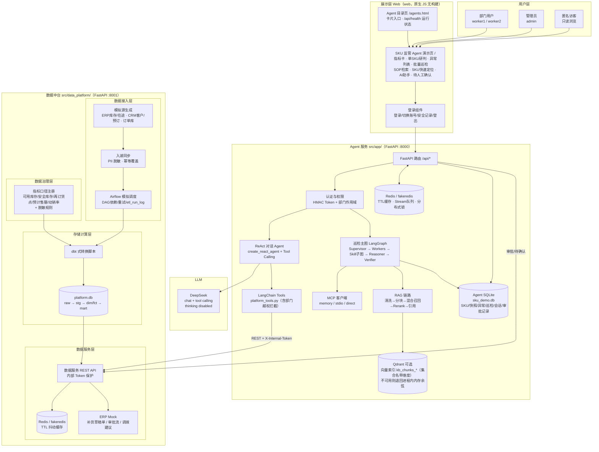
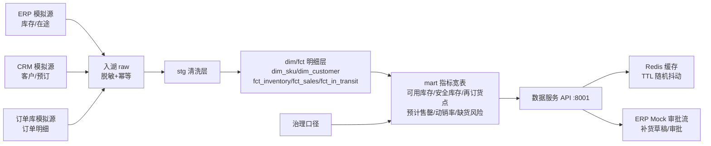
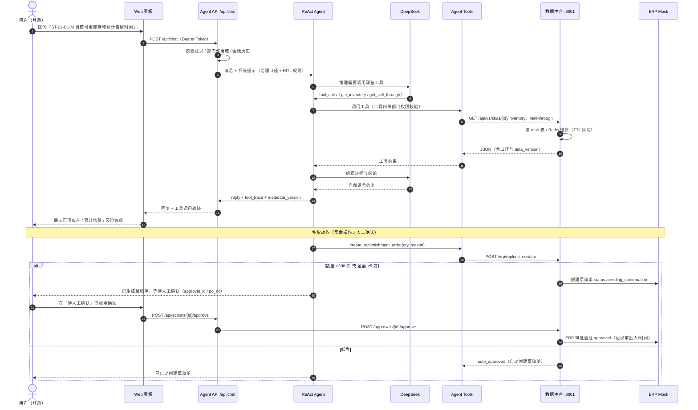

# 项目架构与看板 UI 使用指南

> 适用于当前版本：SKU 监管 Agent（:8000）+ 轻量数据中台（:8001）。演示账号：`admin/hhw123`（管理员）、`worker1/hhw111`（男装部门）、`worker2/hhw222`（女装部门）。
> 前端是 **一页一个 Agent** 的并行结构：`/agents.html` 是 Agent 目录页，`/` 是 SKU 监管 Agent 演示页；新增 Agent 演示 = 加一页 + 在目录页数据里加一条。

---

## 一、详细架构图

### 1.1 总体架构

### 1.2 数据中台内部数据流

### 1.3 用户 ↔ Agent 对话数据流（含 HITL）

---

## 二、页面 UI 功能组件与使用方法

### 2.0 页面结构：Agent 目录页 + 一页一 Agent

| 页面 | 路径 | 作用 | 依赖 |
|---|---|---|---|
| Agent 目录页 | `/agents.html` | 列出全部 Agent 演示页入口 + 运行状态（`/api/health`），**不挂登录、不加载 `app.js`** | `web/agents.html` + `web/agents.js` |
| SKU 监管 Agent 演示页 | `/`（等价 `/index.html`） | 本文 2.1 起的全部面板；登录、指标卡、对话都在这页 | `web/index.html` + `web/app.js` |
| 项目简介 | `/about.html` | `docs/ABOUT.md` 长文自述（`/about.md` 同源）；文首「目录」的锚点链接在页内平滑跳转（标题 id 由 `markdown-lite.js` 按 GitHub 规则生成，页内锚点不开新标签页） | `web/about.html` + `web/markdown-lite.js` |
| 接口文档 | `/api.html` | 同源读取 `/openapi.json` 后用原生 JS 渲染：按 `/api/<段>` 分组、可折叠、支持关键词过滤；**不引用任何 CDN**（FastAPI 自带 `/docs` 在 CSP `default-src 'self'` 下会白屏，故不作为入口） | `web/api.html` + `web/api.js` + `GET /openapi.json` |

**扩展契约**（这就是「方便后期增加 Agent」的入口）：新增一个 Agent 演示页 = ①新增 `web/<page>.html`（复用同一套 header / 面板 / 卡片样式，`style.css` 已含 `.agent-*` 类）②在 `web/agents.js` 的 `AGENT_PAGES` 数组加一条 `{id, name, page, tagline, caps, accounts}`。
目录页按数组顺序渲染卡片；新页面若要服务端注入 `?v=` 版本号，在 `main.py` 再加一条 `render_page_html("<page>.html")` 路由。
`tests/test_ui_pages.py` 会校验「每条 `page` 都指向真实存在的 HTML 文件、`id` 不重复」，忘了加页面会被 CI 拦住。

**失败态**：后端未启动时目录页显示黄色提示条（含一条可直接照做的启动命令）、卡片状态点变灰；卡片仍可点击进入演示页（登录/取数失败由该页自己提示）。

### 2.1 顶部区域

| 组件 | 位置 | 作用 | 数据来源 | 使用说明 |
|---|---|---|---|---|
| Agent 目录入口 | 右上角「🗂 Agent 目录」（项目简介左侧） | 跳到 `/agents.html`：一页一 Agent 的演示入口 | 纯链接，无接口 | 目录页只读 `/api/health` 展示运行状态，不加载看板脚本、不涉及登录态 |
| 徽章：存储 / 缓存 / LLM / MCP | 右上角徽章组（账号左侧） | 展示运行时形态：**存储徽章同时列出关系库与向量库**（`mysql、qdrant` / `sqlite、memory`，悬停看集合名、维度、点数与降级原因）、fakeredis/redis、模型名、MCP 传输（memory/stdio/direct） | `GET /api/health`（公开） | 页面加载时刷新；改 `.env` 后需重启服务并刷新页面 |
| 账号组件 | 右上角徽章右侧 | 登录/查看当前身份/切换账号/安全记录/登出 | `POST /api/auth/login`、`GET /api/auth/me`、`GET /api/auth/security-records`、`POST /api/auth/logout` | 未登录显示「登录账号」；登录后显示 `用户名 · 角色/部门`，点击展开菜单 |

账号菜单三项：

1. **切换账号**：注销当前 Token → 弹出登录框重新登录；
2. **安全记录**：弹窗展示最近登录的账号、**IP、时间**，提示「仅保留近 4 小时记录」（服务端按 4 小时窗口裁剪）；
3. **登出**：Token 立即失效（服务端黑名单），页面回到未登录只读态。

登录账号：

| 账号 | 密码 | 角色 | 数据范围 | SOP 范围 |
|---|---|---|---|---|
| `admin` | `hhw123` | 管理员 | 全部部门汇总，点击卡片看分部门明细 | 全部 SOP |
| `worker1` | `hhw111` | 部门用户 | 男装部门 | 通用 + 男装内部 SOP |
| `worker2` | `hhw222` | 部门用户 | 女装部门（含童装） | 通用 + 女装内部 SOP |

### 2.2 作用域提示与指标卡

- **作用域提示条**（卡片上方）：显示当前视角（未登录只读 / 全部门汇总 / 某部门），以及点击卡片可查看明细的提示。
- **五张指标卡**：

| 卡片 | 含义 | 权限 | 数据来源 | 使用说明 |
|---|---|---|---|---|
| SKU 总数 | 当前数据域 SKU 数；卡片标题带作用域（全部门汇总 / 男装部门） | 匿名/用户/管理员均可看 | `GET /api/metrics` | **点击卡片**：管理员弹出「各部门明细」（男装/女装各自 SKU 数）；部门用户只看本部门；匿名看全部门汇总 |
| 异常 SKU | 最近一次量化筛查命中的异常 SKU 数 | 同上 | `GET /api/metrics` | 点击同上，显示分部门异常数明细 |
| 缓存命中率（Agent 旁路缓存） | Agent 旁路缓存（对话取数 GET / MCP / RAG 检索）的命中率，第二行是延迟 P50/P95（进程级） | 全部 | `GET /api/metrics`、`GET /api/cache/breakdown`（点开看明细） | 全局指标，不区分部门 |
| LLM 调用次数 / token 量（全局） | 调用次数 / 输入+输出 token 累计（k/m 短格式，悬停看明细） | 全部 | `GET /api/metrics` | 用于估算成本；对话/研判/巡检都会累加 |
| 队列 pending / 流长度（全局） | Redis Stream 消费组 PEL 未确认数 / 消息总条数 | 全部 | `GET /api/metrics` | 巡检期间 pending 会短暂 >0，完成后归零 |

### 2.3 单 SKU 研判

- **用途**：对单个 SKU 跑完整多 Agent 链路（Supervisor 拆解 → ERP/拍立淘/RAG 并行 → Skill 子图 → 预案生成 → 校验 Agent），输出风险结论、证据、动作、引用溯源与执行轨迹。
- **使用**：输入 SKU（支持下拉候选，来自 `GET /api/skus` 按账号部门过滤）→ 点「启动研判」或回车 → 约 5~10 秒返回结果。
- **结果区块**：风险徽标；结论；数据证据；处置预案表；Skill 研判（风险标签/健康度/补货建议）；**引用溯源**（SOP 片段 + 已引用标记 + 部门标签）；校验清单（引用有效性/数字一致性/折扣合规/补货合规/SOP 顺序）；执行轨迹（各节点耗时）。
- **权限**：操作需登录；部门用户只能研判本部门 SKU（跨部门 404）。
- **接口**：`POST /api/inspect` → 轮询 `GET /api/inspections/{run_id}`。

### 2.4 异常 SKU 列表

- **用途**：查看多维度量化筛查结果（归一化回归趋势、销量基数、退货率、断码、可售天数、在途覆盖）。
- **使用**：直接浏览表格（SKU/严重度/可售天数/日均销量/原因）；**点击任意行**自动填入并启动该 SKU 研判。
- **权限**：列表按账号部门过滤（数据展示，无需登录）；行点击触发研判（操作），未登录会提示登录。
- **接口**：`GET /api/anomalies`。

### 2.5 批量巡检

- **用途**：模拟生产巡检闭环——量化筛查 → 异常任务入 Redis Stream（幂等去重）→ 批量消费 → 每个异常 SKU 跑研判 → 汇总统计。
- **使用**：选模式（daily/hourly）+ 填本次处理数量（1–50）→「触发巡检」；运行中可点「终止巡检」（协作式停止，已入队的剩余任务不再执行）；下方日志区每 2 秒刷新运行信息，结束后出简报，并保留「巡检日志（最近 10 次）」表（时间 / 操作人 / 模式 / 部门 / 处理 / 失败 / 报告）。
- **日志字段**：`run / status / screened / candidates / selected / skipped_recent / enqueued / deduped / processed / ok / degraded / failed / department / elapsed`。
- **演示点**：同一小时重复触发会看到 `deduped>0、processed=0`（幂等拦截）；部门用户只巡检本部门异常。
- **权限**：操作需登录（未登录点按钮弹登录框）。
- **接口**：`POST /api/patrol` → `GET /api/patrol/{run_id}`。

### 2.6 SOP 知识库检索（RAG）

- **用途**：验证 RAG 链路（查询改写 → 向量 + BM25 混合召回 → Rerank → TopK），不调用 LLM。
- **使用**：输入业务问题（如「大促期间断码如何处理」「换季积压 清仓折扣」）→ 点「检索」；结果展示 `chunk_id、标题、小节、部门标签、score、原文片段`。
- **权限**：数据查询，无需登录即可检索（匿名返回全部 SOP）；登录后按部门过滤（通用 + 本部门内部 SOP）。
- **接口**：`GET /api/rag/search`。

### 2.7 SKU 快速定位

- **用途**：按 SKU / 款号 / 品名模糊搜索，快速定位到某个 SKU 并发起研判。
- **使用**：输入关键词（如 `ST-12`、`羽绒`）→「搜索」→ 结果表（SKU/款名含颜色尺码/库存/仓）；**点击行**自动进入「单 SKU 研判」并启动。
- **权限**：搜索为数据查询（无需登录，匿名返回全部）；点击行触发研判（操作，需登录）。登录后按账号部门过滤，跨部门搜不到。
- **接口**：`GET /api/skus?q=&limit=30`。

### 2.8 AI 助手（自然语言问数 / 智能诊断 / 自动补货）

- **用途**：ReAct Agent 对话入口。
  - **问数**：如「ST-01-C1-M 当前可用库存和预计售罄时间」，Agent 调中台接口取数后回答）；
  - **诊断**：如「某 SKU 是否面临断货风险，请结合 CRM 预订和订单给出影响评估」；
  - **补货**：如「库存偏低，帮我生成补货草稿单（数量按建议/指定 300 件）」。
- **使用**：
  1. 登录后打开面板；
  2. 点击示例问题按钮，或输入问题后「发送」/回车；
  3. Agent 的答案**逐字流式出现**（SSE `delta` 事件，气泡末尾有闪烁光标；最终内容以 `done` 为准，因为溯源校验可能重写数字与来源）；回复中可展开 **「工具调用轨迹」** 查看调用了哪些中台接口、入参与结果；
  4. 同一会话内可**多轮追问**（如「那需要补货吗？补多少？」）；
  5. 点「新会话」清空当前上下文。
- **HITL 行为**：补货数量 ≥200 件或金额 ≥5 万元 → Agent 回复「已生成补货草稿单，等待人工确认」并给出 `approval_id / po_no`，**不会**声称已审批；低于阈值则自动通过。
- **溯源告警条**：答案上方可能出现黄条「⚠️ 溯源自检未通过」——说明本轮答案里还有数字没能追溯到 `result_id`（校验器已尝试重写一次）。绿条「✅ 溯源自检：已自动补齐数字来源标注」表示重写后通过。点「显示运行详情」→ 第 ⑥ 段可看到具体问题、引用数量、无法回溯的数字列表。
- **权限**：对话属于操作，必须登录；部门用户只能问本部门 SKU（越权会返回「无权限」，不泄露数据）。
- **会话与账号**：会话按账号隔离；切换账号/登出/登录失效后会自动清空旧会话并开启新会话。若前端仍携带其他账号的旧 session_id（例如切换账号前发起过对话），后端会返回「会话不存在或无权访问」，前端会**自动开启新会话并重试**，无需手动刷新。
- **Agent 路由**：问题按关键词/意图路由到 3 个 Agent（`analyst` 通用问数、`diagnostician` 库存诊断、`operator` 建单/售后/物流），
  答案下方证据链显示 `agent:<id>@<version>`；`GET /api/agents` 可看当前可用 Agent 与版本。
- **接口**：`POST /api/chat`（返回 reply + tool_trace + session_id + agent）、`GET /api/agents`、`GET /api/chat/sessions`、`GET /api/chat/{sid}`、`POST /api/chat/{sid}/reset`。

### 2.9 人工确认（补货单 + 售后工单）

- **用途**：两类「Agent 只建草稿、人来做决定」的动作都在这一张卡里：
  - **补货单**：高危补货（数量 ≥200 件或金额 ≥5 万元）不直接下单，生成「补货草稿单」等人工确认后才流转到 Mock ERP；
  - **售后工单**：Agent 生成的退款/换货建议（如「这单能不能退」）以 `pending_confirmation` 出现，确认后才算处理完成（演示环境不会真退款）。
- **怎么产生待确认项**：在「AI 助手」里让 Agent 补货即可，例如：
  - `ST-02-C1-M 可用库存为 0，请生成补货草稿单，数量按 300 件创建。`（高额 → 进入待确认）
  - 或点面板上的「生成演示草稿单」按钮一键触发。
  低于阈值的补货（如 20 件）会 `auto_approved` 自动通过，不会进入待确认列表。
- **列表保留策略**：确认/驳回后记录**不会消失**，状态变为「已确认 / 已驳回」；列表仅展示**近 4 小时**内的补货单（平台按 `created_at` 过滤，数据库仍保留历史记录）；面板与详情弹层均有「仅保留近 4 小时记录」提示。之后再次刷新或新补货会继续追加。
- **怎么处理**：登录后表格展示 SKU / 数量 / 金额 / 状态 / 操作：
  - 「确认」→ 二次确认框 → 调用中台审批 → Mock ERP 状态变 `approved`（记录审批账号/时间）；
  - 「驳回」→ 填原因 → 状态变 `rejected`；
  - 「详情」→ 弹层展示：审批账号、确认/驳回时间、当前可用库存、现存、日均销量、采购件数、金额、ERP 单号、发起原因等关键数据（待确认时审批账号显示「待确认」）。
- **权限**：需登录；部门用户只能看到/处理本部门 SKU 的补货单（后端二次校验）；管理员可处理全部。
- **售后工单表**：列 订单号 / SKU / 原因 / 数量 / 状态（含审批账号与时间）/ 操作；待确认行有「确认」「驳回」，已处理行有「详情」（含批注）。
- **重复处理**：同一工单再点确认会返回 409（后端拦），界面提示「该工单已处理」。
- **接口**：
  - 补货：`GET /api/actions/list`（status=all，within 4h）、`GET /api/actions/pending`、`POST /api/actions/{id}/approve|reject` →（内部调用中台）`/api/v1/approvals/*`；
  - 售后：`GET /api/actions/after-sales?status=pending|approved|rejected|all`、`POST /api/actions/after-sales/{ticket_id}/approve|reject`。

### 2.10 通用弹窗

- **登录弹窗**：用户名/密码 + 错误提示 + 演示账号提示；回车提交、Esc/取消关闭。
- **部门明细弹窗**：管理员点击「SKU 总数 / 异常 SKU」卡片时弹出，展示各部门数据量；匿名只读看全部门汇总；部门用户只看本部门。
- **安全记录弹窗**：显示账号/登录 IP/时间，顶部提示「仅保留近 4 小时记录」。

---

## 三、推荐演示路径

0. 先到 `/agents.html`（Agent 目录页）：一眼看到「一页一个 Agent」的结构与当前唯一在线 Agent，再点「进入演示 →」；
1. 未登录：页面可只读浏览（指标/异常列表/SOP 检索/卡片明细）；
2. 登录 `admin/hhw123`：看全部门汇总 → 点两张卡片看部门明细 → 点「启动研判」看完整 Agent 链路与引用溯源；
3. 打开「AI 助手」：问「ST-01-C1-M 当前可用库存和预计售罄时间」→ 看工具轨迹 → 追问补货数量；
4. 发「ST-02-C1-M 可用库存为 0，请生成补货草稿单，数量按 300 件创建」→ 看「待人工确认」出现草稿 → 点确认 → Mock ERP approved；
5. 切换 `worker1/hhw111`：指标/列表/SOP/搜索只剩男装；问女装 SKU 会提示无权限；
6. 打开「安全记录」看近 4 小时登录 IP/时间。

---

## 四、接口与权限速查

| 组件 | 主接口 | 需登录 |
|---|---|---|
| 徽章/指标卡 | `/api/health`、`/api/metrics` | 否（匿名只读） |
| 单 SKU 研判 | `POST /api/inspect`、`GET /api/inspections/{id}` | 发起需登录，结果读取只读 |
| 异常列表 | `GET /api/anomalies` | 否（按账号过滤） |
| 批量巡检 | `POST /api/patrol`、`GET /api/patrol/{id}` | 发起需登录 |
| SOP 检索 | `GET /api/rag/search` | 否（登录后按部门过滤） |
| SKU 快速定位 | `GET /api/skus` | 否（登录后按部门过滤） |
| AI 助手 | `POST /api/chat` | 是 |
| 待人工确认 | `GET /api/actions/pending`、`POST /api/actions/{id}/approve|reject` | 是 |
| 账号/安全记录 | `/api/auth/*` | 登录/登出/安全记录需登录，登录接口公开 |

> **匿名只读的范围**：上表标"否"的读接口不登录也能看，匿名按"全部门只读"渲染（登录账号按部门过滤），
> `run_id` 是 uuid、不可枚举；写操作与 `/api/patrol/recent`、`/api/chat/*` 仍需登录。
> 生产化时把入口收敛到 `require_user`，详见 [docs/ARCHITECTURE.md](ARCHITECTURE.md) 第 4 节。

---

## 生图 Agent 页面（`/image.html`）

一页一 Agent：本页只加载 `web/image.js`（管理员再加载 `web/image_admin.js`），**不加载 `app.js`**，
登录态存在 `localStorage.image_agent_token`，与 SKU 页完全隔离。

| 区域 | 内容 |
|---|---|
| 顶部徽标 | 服务状态（`/api/image/health`）、数据源（中台 MCP / 本地替身）、产线（provider）、当前账号 |
| 登录卡片 | 独立账号登录；演示账号写在提示里；默认密钥会提示"上线前改掉" |
| 商品清单 | 搜索 + 勾选（≤5 个），显示类目与"是否有参考图"；**没有上传入口** |
| 参数区 | 构图 / 场景风格（来自 `/api/image/catalog`）、张数（默认取 `plan_policy`）、比例（默认取平台规则） |
| 需求 | 自然语言描述；提交后返回 `batch_id` 与每个商品的任务 |
| 进度 | 每条任务一行，状态/回写状态实时更新（SSE：`snapshot → stage → asset → backfill → done`） |
| 画廊 | 按图位卡片展示产出图、尺寸与 sha256，并附中台参考图缩略图 |
| 管理面板 | 仅管理员：粒度切换（月/周/日/小时）、账户筛选、5 张指标卡、**手绘 SVG 折线图**（悬停显示按账户细分）、任务表、账号与配额表、"重放回写"按钮 |

约束：CSP 为 `script-src 'self'`，因此页面只用外链脚本 + `createElementNS` 手绘图表，无任何第三方前端库。
